# Yalla Backend ERD — Revised

This is the conceptual ERD for the Yalla passenger backend and the shared
order/dispatch/financial domain. It includes the captain data required by the
Passenger App, dispatch, live tracking, and commission accounting, and the
captain verification data (documents, vehicle approval, expiry) required by the
Captain App. Other captain-app operational details (working schedules,
captain-specific settings) remain deferred.

It supports the currently agreed product rules:

- The passenger creates a ride and proposes the fare.
- Nearby captains receive dispatch offers. The passenger does **not** browse
  and select a list of captains.
- A captain may accept, reject, or counter-offer. A counter-offer becomes the
  agreed fare only after the passenger accepts it.
- The first valid captain acceptance wins. Only one active assignment may
  exist for an order at a time.
- The passenger pays the captain in cash. Yalla records a 15% commission debt
  owed by the captain; it is not an in-app passenger payment.
- Store delivery is a request for items from a restaurant/store, not a
  sender-to-receiver parcel workflow. The request contains item details and
  supports recording the actual store receipt.
- A captain may receive work only while their account is verified, their
  vehicle and vehicle photos are verified, and every required verification
  document is verified **and not expired**. A document can be renewed while the
  old one is still valid.

The diagram is a logical model. Choose physical table names, column types,
indexes, and database-specific constraints during implementation.

## Core ERD

```mermaid
erDiagram
    PASSENGER ||--o{ AUTH_SESSION : has
    PASSENGER ||--o{ DEVICE_PUSH_TOKEN : registers
    PASSENGER ||--o{ SAVED_PLACE : saves
    PASSENGER ||--o{ TRUSTED_CONTACT : trusts
    PASSENGER ||--o{ ORDER : creates
    PASSENGER ||--o{ NOTIFICATION : receives
    PASSENGER ||--o| NOTIFICATION_SETTINGS : configures

    ORDER ||--o| RIDE_ORDER : specializes
    ORDER ||--o| PARCEL_ORDER : specializes
    ORDER ||--o| STORE_DELIVERY_ORDER : specializes
    ORDER ||--o{ ORDER_CAPTAIN_OFFER : dispatches
    ORDER ||--o{ ORDER_ASSIGNMENT : assignment_history
    ORDER ||--o{ ORDER_STATUS_HISTORY : tracks_status
    ORDER ||--o{ ORDER_TRACKING_POINT : tracks_location
    ORDER ||--o{ ORDER_FARE_LINE : breaks_down_fare
    ORDER ||--o{ ORDER_PAYMENT : records_payment
    ORDER ||--o| ORDER_RATING : receives_rating
    ORDER ||--o{ ORDER_SHARE : shares
    ORDER ||--o{ HELP_REQUEST : has
    ORDER ||--o{ CHAT_MESSAGE : contains
    ORDER ||--o{ ORDER_ATTACHMENT : has
    FILE_UPLOAD ||--o{ ORDER_ATTACHMENT : attached_as

    STORE ||--o{ STORE_DELIVERY_ORDER : fulfills
    STORE_DELIVERY_ORDER ||--|{ DELIVERY_ITEM : contains
    STORE_DELIVERY_ORDER ||--o{ DELIVERY_RECEIPT : records

    CAPTAIN ||--o{ ORDER_CAPTAIN_OFFER : receives
    CAPTAIN ||--o| CAPTAIN_LOCATION : reports
    CAPTAIN ||--o{ ORDER_ASSIGNMENT : assigned_to
    CAPTAIN ||--o{ CAPTAIN_VEHICLE : owns_or_operates
    CAPTAIN ||--o{ CAPTAIN_DOCUMENT : submits
    CAPTAIN ||--o{ CAPTAIN_STATUS_HISTORY : tracks_status
    CAPTAIN ||--o{ NOTIFICATION : receives
    CAPTAIN ||--o{ DEVICE_PUSH_TOKEN : registers
    CAPTAIN_VEHICLE ||--o{ CAPTAIN_VEHICLE_PHOTO : has
    CAPTAIN_VEHICLE ||--o{ CAPTAIN_DOCUMENT : "registration / insurance"
    CAPTAIN_DOCUMENT ||--|{ CAPTAIN_DOCUMENT_FILE : "front / back photos"
    CAPTAIN_DOCUMENT ||--o| CAPTAIN_DOCUMENT : replaces
    CAPTAIN_DOCUMENT ||--o{ NOTIFICATION : "reminds about"
    FILE_UPLOAD ||--o{ CAPTAIN_DOCUMENT_FILE : stores
    FILE_UPLOAD ||--o{ CAPTAIN_VEHICLE_PHOTO : stores
    STAFF_USER ||--o{ CAPTAIN_DOCUMENT : reviews
    STAFF_USER ||--o{ CAPTAIN_VEHICLE : reviews
    STAFF_USER ||--o{ CAPTAIN_VEHICLE_PHOTO : reviews
    STAFF_USER ||--o{ CAPTAIN_STATUS_HISTORY : changes
    CAPTAIN ||--o| CAPTAIN_WALLET : has
    CAPTAIN_WALLET ||--o{ WALLET_TRANSACTION : records
    CAPTAIN_SETTLEMENT ||--o{ WALLET_TRANSACTION : posts
    ORDER ||--o| ORDER_FINANCIAL : settles
    CAPTAIN ||--o{ ORDER_FINANCIAL : earns
    CAPTAIN ||--o{ CAPTAIN_SETTLEMENT : settles_commission

    ORDER_RATING }o--|| CAPTAIN : rates
    CHAT_MESSAGE }o--o| CAPTAIN : captain_sender
    CHAT_MESSAGE }o--o| PASSENGER : passenger_sender
    HELP_REQUEST }o--|| HELP_ISSUE : uses

    PASSENGER {
        uuid id PK
        string phoneNumber UK
        string fullName
        string email
        string avatarUrl
        date dateOfBirth
        enum gender
        datetime createdAt
        datetime updatedAt
        datetime deletedAt
    }

    AUTH_VERIFICATION {
        uuid id PK
        string phoneNumber
        enum purpose
        string codeHash
        int failedAttempts
        datetime expiresAt
        datetime verifiedAt
        datetime consumedAt
        datetime createdAt
    }

    AUTH_SESSION {
        uuid id PK
        uuid passengerId FK
        string refreshTokenHash UK
        string deviceId
        string deviceName
        datetime expiresAt
        datetime lastUsedAt
        datetime revokedAt
        datetime createdAt
    }

    DEVICE_PUSH_TOKEN {
        uuid id PK
        uuid passengerId FK
        uuid captainId FK
        string token UK
        enum platform
        enum provider
        datetime lastSeenAt
        datetime revokedAt
        datetime createdAt
    }

    SAVED_PLACE {
        uuid id PK
        uuid passengerId FK
        enum type
        string name
        string address
        decimal latitude
        decimal longitude
        datetime createdAt
        datetime updatedAt
    }

    TRUSTED_CONTACT {
        uuid id PK
        uuid passengerId FK
        string name
        string phone
        datetime createdAt
    }

    STORE {
        uuid id PK
        string name
        enum category
        string cuisine
        decimal rating
        int ratingCount
        string imageUrl
        boolean isActive
        boolean isOpen
        string address
        decimal latitude
        decimal longitude
        string phone
        datetime createdAt
        datetime updatedAt
    }

    ORDER {
        uuid id PK
        uuid passengerId FK
        enum serviceType
        string orderNumber UK
        enum status
        datetime createdAt
        datetime updatedAt
        datetime completedAt
        datetime cancelledAt
        uuid cancelledBy
        enum cancelledByType "PASSENGER | CAPTAIN | SYSTEM"
        enum cancelReasonCode "CUSTOMER_NOT_RESPONDING | CUSTOMER_REQUESTED | VEHICLE_PROBLEM | OTHER"
        string cancelReason
        datetime expiresAt
    }

    RIDE_ORDER {
        uuid orderId PK, FK
        enum vehicleType
        decimal pickupLatitude
        decimal pickupLongitude
        string pickupAddress
        decimal destinationLatitude
        decimal destinationLongitude
        string destinationAddress
        int estimatedDistanceMeters
        int estimatedDurationSeconds
        int passengerOfferedFarePiastres
        int agreedFarePiastres
        string passengerNote
    }

    PARCEL_ORDER {
        uuid orderId PK, FK
        string pickupLabel
        decimal pickupLatitude
        decimal pickupLongitude
        string destinationLabel
        decimal destinationLatitude
        decimal destinationLongitude
        int estimatedDistanceMeters
        int estimatedDurationSeconds
        string senderName
        string senderPhone
        string receiverName
        string receiverPhone
        enum packageType
        enum packageSize
        string packageDescription
        int quantity
        boolean isFragile
        int declaredValuePiastres
        enum paidBy
        string deliveryNotes
    }

    STORE_DELIVERY_ORDER {
        uuid orderId PK, FK
        uuid storeId FK
        string storeNameSnapshot
        string pickupAddressSnapshot
        string storePhoneSnapshot
        decimal pickupLatitude
        decimal pickupLongitude
        string destinationLabel
        string destinationAddress
        decimal destinationLatitude
        decimal destinationLongitude
        int estimatedDistanceMeters
        int estimatedDurationSeconds
        string customerInstructions
        int estimatedItemsAmountPiastres
        int actualReceiptAmountPiastres
        enum receiptStatus
    }

    DELIVERY_ITEM {
        uuid id PK
        uuid storeDeliveryOrderId FK
        string name
        string details
        decimal quantity
        string unit
        int estimatedUnitPricePiastres
        enum status
    }

    DELIVERY_RECEIPT {
        uuid id PK
        uuid storeDeliveryOrderId FK
        uuid fileUploadId FK
        int amountPiastres
        datetime purchasedAt
        datetime uploadedAt
    }

    CAPTAIN {
        uuid id PK
        string phoneNumber UK
        string fullName
        string email
        string avatarUrl
        date dateOfBirth
        string nationality
        enum gender
        enum verificationStatus "PENDING | UNDER_REVIEW | VERIFIED | REJECTED | SUSPENDED"
        string rejectionReason
        datetime verifiedAt
        datetime suspendedAt
        string suspensionReason
        enum availabilityStatus "OFFLINE | ONLINE"
        datetime availabilityChangedAt
        decimal rating
        int ratingCount
        int tripsCount
        datetime createdAt
        datetime updatedAt
    }

    CAPTAIN_VEHICLE {
        uuid id PK
        uuid captainId FK
        enum type "CAR | MOTORCYCLE | SCOOTER | BICYCLE"
        string make
        string model
        int year
        string color
        string plateNumber UK
        boolean isActive
        enum verificationStatus "PENDING | UNDER_REVIEW | VERIFIED | REJECTED"
        string rejectionReason
        datetime reviewedAt
        uuid reviewedByStaffId FK
        datetime createdAt
        datetime updatedAt
    }

    CAPTAIN_VEHICLE_PHOTO {
        uuid id PK
        uuid vehicleId FK
        uuid fileUploadId FK
        enum photoType "FRONT | SIDE | REAR"
        enum verificationStatus "PENDING | UNDER_REVIEW | VERIFIED | REJECTED"
        string rejectionReason
        datetime reviewedAt
        uuid reviewedByStaffId FK
        datetime createdAt
        datetime updatedAt
    }

    CAPTAIN_DOCUMENT {
        uuid id PK
        uuid captainId FK
        uuid vehicleId FK
        enum documentType "NATIONAL_ID | DRIVING_LICENSE | VEHICLE_REGISTRATION | VEHICLE_INSURANCE | PROFILE_PHOTO"
        string documentNumberEncrypted
        string documentNumberLast4
        date issuedAt
        date expiresAt
        enum verificationStatus "PENDING | UNDER_REVIEW | VERIFIED | REJECTED"
        datetime submittedAt
        datetime reviewedAt
        uuid reviewedByStaffId FK
        string rejectionReason
        datetime supersededAt
        uuid replacesDocumentId FK
        int lastExpiryReminderStage "30 | 7 | 1 | 0 | null"
        datetime createdAt
        datetime updatedAt
    }

    CAPTAIN_DOCUMENT_FILE {
        uuid id PK
        uuid documentId FK
        uuid fileUploadId FK
        enum side "FRONT | BACK | SINGLE"
        datetime createdAt
    }

    CAPTAIN_DOCUMENT_REQUIREMENT {
        uuid id PK
        enum vehicleType "CAR | MOTORCYCLE | SCOOTER | BICYCLE"
        enum documentType "NATIONAL_ID | DRIVING_LICENSE | VEHICLE_REGISTRATION | VEHICLE_INSURANCE | PROFILE_PHOTO"
        boolean isRequired
        boolean requiresExpiryDate
        boolean requiresBackSide
        int expiryWarningDays
        datetime createdAt
        datetime updatedAt
    }

    CAPTAIN_STATUS_HISTORY {
        uuid id PK
        uuid captainId FK
        enum fromStatus "PENDING | UNDER_REVIEW | VERIFIED | REJECTED | SUSPENDED"
        enum toStatus "PENDING | UNDER_REVIEW | VERIFIED | REJECTED | SUSPENDED"
        string reason
        uuid changedByStaffId FK
        datetime createdAt
    }

    STAFF_USER {
        uuid id PK
        string fullName
        string email UK
        enum role "ADMIN | REVIEWER"
        boolean isActive
        datetime createdAt
        datetime updatedAt
    }

    CAPTAIN_LOCATION {
        uuid captainId PK, FK
        decimal latitude
        decimal longitude
        string h3Index
        decimal heading
        decimal accuracy
        datetime updatedAt
    }

    ORDER_CAPTAIN_OFFER {
        uuid id PK
        uuid orderId FK
        uuid captainId FK
        int dispatchRound
        enum status
        int passengerOfferedFarePiastres
        int captainCounterFarePiastres
        enum counterOfferStatus
        string captainMessage
        datetime sentAt
        datetime expiresAt
        datetime captainRespondedAt
        datetime passengerRespondedAt
    }

    ORDER_ASSIGNMENT {
        uuid id PK
        uuid orderId FK
        uuid captainId FK
        uuid acceptedOfferId FK
        enum status
        datetime assignedAt
        datetime captainArrivedAt
        datetime startedAt
        datetime endedAt
        datetime createdAt
    }

    ORDER_STATUS_HISTORY {
        uuid id PK
        uuid orderId FK
        enum fromStatus
        enum toStatus
        string changedByType
        uuid changedById
        string reason
        datetime createdAt
    }

    ORDER_TRACKING_POINT {
        uuid id PK
        uuid orderId FK
        uuid captainId FK
        decimal latitude
        decimal longitude
        decimal heading
        decimal speed
        decimal accuracy
        int etaSeconds
        datetime recordedAt
    }

    ORDER_FARE_LINE {
        uuid id PK
        uuid orderId FK
        string label
        enum kind
        int amountPiastres
        datetime createdAt
    }

    ORDER_PAYMENT {
        uuid id PK
        uuid orderId FK
        uuid captainId FK
        enum purpose
        enum method
        enum status
        int amountPiastres
        string paidByType
        string paidToType
        datetime collectedAt
        datetime createdAt
    }

    ORDER_FINANCIAL {
        uuid id PK
        uuid orderId FK
        uuid captainId FK
        int grossFarePiastres
        int commissionRateBasisPoints
        int commissionAmountPiastres
        int captainNetAmountPiastres
        enum settlementStatus
        datetime calculatedAt
    }

    CAPTAIN_WALLET {
        uuid id PK
        uuid captainId FK
        int balancePiastres
        datetime updatedAt
    }

    WALLET_TRANSACTION {
        uuid id PK
        uuid walletId FK
        uuid orderFinancialId FK
        uuid settlementId FK
        enum type
        int amountPiastres
        int balanceAfterPiastres
        string reference
        string description
        datetime createdAt
    }

    CAPTAIN_SETTLEMENT {
        uuid id PK
        uuid captainId FK
        int amountPiastres
        enum method
        enum status
        string reference
        datetime requestedAt
        datetime settledAt
    }

    ORDER_RATING {
        uuid id PK
        uuid orderId FK
        uuid passengerId FK
        uuid captainId FK
        int stars
        string comment
        int tipPiastres
        datetime createdAt
    }

    ORDER_SHARE {
        uuid id PK
        uuid orderId FK
        string tokenHash UK
        int contactsSent
        datetime createdAt
        datetime expiresAt
        datetime revokedAt
    }

    NOTIFICATION {
        uuid id PK
        uuid passengerId FK
        uuid captainId FK
        uuid orderId FK
        uuid captainDocumentId FK
        enum type
        string title
        string body
        boolean isRead
        datetime readAt
        datetime createdAt
    }

    NOTIFICATION_SETTINGS {
        uuid passengerId PK, FK
        boolean orders
        boolean chat
        boolean promos
        datetime updatedAt
    }

    HELP_ISSUE {
        uuid id PK
        string label
        string hint
        boolean detailsRequired
        boolean isActive
    }

    HELP_REQUEST {
        uuid id PK
        uuid orderId FK
        uuid passengerId FK
        uuid issueId FK
        string message
        string ticketNumber UK
        enum status
        datetime createdAt
        datetime updatedAt
    }

    CHAT_MESSAGE {
        uuid id PK
        uuid orderId FK
        uuid passengerId FK
        uuid captainId FK
        string text
        enum status
        datetime createdAt
        datetime deliveredAt
        datetime readAt
    }

    FILE_UPLOAD {
        uuid id PK
        string storageKey UK
        string url
        string originalName
        string mimeType
        bigint sizeBytes
        string folder
        uuid uploadedById
        string uploadedByType
        datetime createdAt
        datetime deletedAt
    }

    ORDER_ATTACHMENT {
        uuid id PK
        uuid orderId FK
        uuid fileUploadId FK
        enum purpose
        datetime createdAt
    }
```

## Important domain rules and constraints

### 1. Orders and subtypes

- `ORDER` is the shared order aggregate for rides, parcels, and store
  deliveries.
- `serviceType` determines exactly one matching subtype. Enforce that every
  order has one and only one subtype matching its `serviceType`; a normal
  foreign key alone cannot enforce this cross-table rule.
- Store money as integer piastres (`1 EGP = 100 piastres`). Use sufficiently
  large integer types for totals and ledger balances.
- Keep `createdAt`, `updatedAt`, and lifecycle timestamps in UTC.
- Use soft deletion only where the business needs it; do not cascade-delete
  financial, order, or audit history.

### 2. Ride fare negotiation and dispatch

- `RIDE_ORDER.passengerOfferedFarePiastres` stores the fare proposed by the
  passenger when creating the ride.
- `ORDER_CAPTAIN_OFFER` is the dispatch invitation sent to each candidate
  captain. It replaces the original ambiguous use of `ORDER_COUNTER_OFFER`.
- A captain's normal acceptance accepts the passenger's offered fare.
- A captain counter-offer stores `captainCounterFarePiastres` and sets
  `counterOfferStatus = PENDING`. The passenger must explicitly accept or
  reject it.
- On passenger acceptance, copy the accepted amount into
  `RIDE_ORDER.agreedFarePiastres`. Once the ride is accepted, this agreed fare
  must be immutable except through an explicit audited adjustment workflow.
- The first valid acceptance wins. In one database transaction, verify that
  the order is still searchable and unassigned, accept the offer, create the
  active `ORDER_ASSIGNMENT`, set the order status, and expire/cancel competing
  offers. Use concurrency protection (row lock, optimistic concurrency token,
  or equivalent) so two captains cannot win.
- Do not expose a captain-selection list as the dispatch mechanism. Candidate
  discovery and offer delivery are backend-controlled.
- `ORDER_ASSIGNMENT` is history, not a one-to-one current pointer. An order
  can have multiple historical assignments if reassignment is supported, but
  it must have at most one active assignment at a time.
- Keep order status history in `ORDER_STATUS_HISTORY`; current status on
  `ORDER` is the fast-read snapshot.

Suggested ride lifecycle:

`SEARCHING → ACCEPTED → ARRIVED → IN_PROGRESS → COMPLETED`

Terminal/alternate states include `CANCELLED` and `EXPIRED`. Define the
allowed transitions centrally and record every transition. If a captain
rejects or lets an offer expire, that changes the offer state, not the whole
order while other candidates are still eligible.

### 3. Cash payment and 15% commission

- MVP passenger-to-captain payment is cash. `ORDER_PAYMENT` records each cash
  collection against the order; use `purpose` (for example `RIDE_FARE`,
  `GOODS`, or `SERVICE_FEE`) to keep goods reimbursement separate from the
  service fee. It is not a card/payment-gateway integration.
- For every completed order (ride, parcel, or store delivery), create one
  immutable `ORDER_FINANCIAL` snapshot:
  - `grossFarePiastres`: the service fare only (the ride fare, the parcel
    shipping fee, or the store-delivery fee). Goods the captain buys and is
    reimbursed for are recorded in `ORDER_PAYMENT` (`GOODS`) and are never part
    of the gross, the commission, or the captain's earnings.
  - `commissionRateBasisPoints`: `1500` (15%) for rides. For parcels and store
    deliveries it is a configured rate per `serviceType`, and `0` when no
    commission applies. Create the snapshot even when the rate is `0`, so the
    captain's net earnings are always recorded.
  - `commissionAmountPiastres`
  - `captainNetAmountPiastres`
- Since the captain receives the passenger's cash directly, the commission is
  a debt owed by the captain to Yalla. Create the corresponding
  `WALLET_TRANSACTION` ledger entry; do not treat the commission as money
  automatically collected by Yalla.
- `CAPTAIN_WALLET.balancePiastres` is a cached **commission debt** balance:
  positive means the captain owes Yalla. A commission-accrual transaction
  increases the debt; a successful settlement decreases it. The transaction
  ledger is the source of truth and must be updated atomically with the balance.
- `CAPTAIN_SETTLEMENT` records later payments made by captains to Yalla against
  their outstanding commission debt. Do not confuse these settlements with
  passenger payments.
- Keep financial records even if an order is cancelled or refunded. For
  cancellation fees or adjustments, add explicit financial entries rather
  than editing completed financial snapshots.

### 4. Store delivery

- `STORE_DELIVERY_ORDER` represents the passenger asking a captain to obtain
  requested goods from a store and deliver them to the passenger.
- Store requested goods as rows in `DELIVERY_ITEM`, not only as one free-text
  `itemsText` field. `customerInstructions` can retain extra free text.
- Store the selected store's name, pickup address, and phone as snapshots so
  historical orders remain understandable if the store profile changes.
- `RIDE_ORDER`, `PARCEL_ORDER`, and `STORE_DELIVERY_ORDER` all carry
  `estimatedDistanceMeters` and `estimatedDurationSeconds`, because the
  dispatch offer and the order history need them for every service type. They
  are estimates captured when the request is created, not measured values; the
  measured route comes from `ORDER_TRACKING_POINT`.
- Record the actual purchase receipt in `DELIVERY_RECEIPT`, linked to
  `FILE_UPLOAD`, and store its actual amount. `estimatedItemsAmountPiastres`
  and `actualReceiptAmountPiastres` are different values.
- Keep the delivery/service fee separate from the goods receipt amount using
  `ORDER_FARE_LINE`. Define explicitly in the API whether the passenger pays
  the captain for the goods, the delivery fee, or both, and when each amount is
  collected. Do not silently combine receipt value and service fee.
- `PARCEL_ORDER` remains a separate sender/receiver parcel workflow. Do not
  use it to model store shopping/delivery.

### 5. Captain data and verification

Captain data covers what the Passenger App, dispatch, and commission accounting
need, plus the verification data the Captain App needs:

- `CAPTAIN` stores the captain's profile (name, phone, email, photo, date of
  birth, nationality, gender), the passenger-visible rating, rating count, and
  completed-trip count, the verification state (`verificationStatus`,
  `rejectionReason`, `verifiedAt`, and the suspension fields), and
  `availabilityStatus` (`OFFLINE` or `ONLINE`). Phone numbers follow the same
  normalization and uniqueness rule as `PASSENGER`.
- Every change of `CAPTAIN.verificationStatus` writes a `CAPTAIN_STATUS_HISTORY`
  row (append-only). A null `changedByStaffId` means the system made the change.
- `CAPTAIN_VEHICLE` stores the vehicle details displayed to passengers after a
  captain is assigned, and its own review state (`verificationStatus`,
  `rejectionReason`, `reviewedAt`, `reviewedByStaffId`). A captain can have
  several vehicle records over time but at most one active (`isActive`).
  `plateNumber` is required unless the type is `BICYCLE`. `RIDE_ORDER.vehicleType`
  and `CAPTAIN_VEHICLE.type` must use the same `VehicleType` values so dispatch
  can match them.
- `CAPTAIN_VEHICLE_PHOTO` stores the `FRONT`, `SIDE`, and `REAR` photos of a
  vehicle, each with its own review state. Replacing a photo overwrites the row
  and resets its status to `PENDING`. File metadata stays in `FILE_UPLOAD`.
- `CAPTAIN_LOCATION` stores the latest captain location needed for nearby
  dispatch and live tracking. A Redis/geospatial cache may serve high-frequency
  location reads; the database record can remain the durable snapshot.
- `ORDER_ASSIGNMENT` and `ORDER_CAPTAIN_OFFER` connect captains to orders.
- `CAPTAIN_WALLET`, `WALLET_TRANSACTION`, `ORDER_FINANCIAL`, and
  `CAPTAIN_SETTLEMENT` remain in scope now because commission debt and its
  accounting are core business rules, even if captain-facing wallet screens
  and settlement APIs are implemented later.
- `CAPTAIN_DOCUMENT` is one logical document (national ID, driving licence,
  vehicle registration, vehicle insurance, or profile photo) with one expiry
  date and one review decision. Its photos are `CAPTAIN_DOCUMENT_FILE` rows
  (`FRONT` + `BACK`, or `SINGLE`), never separate document types. `vehicleId` is
  set only for registration and insurance. `documentNumberEncrypted` is
  encrypted at rest and only `documentNumberLast4` is ever shown. Files are
  private and served through short-lived signed URLs. Documents are never
  hard-deleted, so old versions stay available for audit.
- `CAPTAIN_DOCUMENT_REQUIREMENT` is configuration data, not code: for each
  vehicle type it says which documents are required, which need an expiry date
  or a back side, and how many days before expiry to start warning
  (`expiryWarningDays`, default 30). A combination with no row is not
  applicable. Seed rows:
  - `NATIONAL_ID`: all four vehicle types; required; expiry date; back side.
  - `DRIVING_LICENSE` and `VEHICLE_REGISTRATION`: `CAR`, `MOTORCYCLE`,
    `SCOOTER`; required; expiry date; back side.
  - `VEHICLE_INSURANCE`: `CAR` required; `MOTORCYCLE` and `SCOOTER` optional
    (`isRequired = false`); expiry date; single file.
  - `PROFILE_PHOTO`: all four vehicle types; required; no expiry; single file.
- A **slot** is `(captainId, documentType, vehicleId)`, with `vehicleId` null
  for personal documents. The **active** document of a slot is its newest
  `VERIFIED` row with `supersededAt` null. An **open submission** is a `PENDING`
  or `UNDER_REVIEW` row. A slot has at most one active document and at most one
  open submission.
- Renewal: a captain may submit a replacement at any time, even while the
  active document is `VERIFIED`. The new row starts `PENDING` with
  `replacesDocumentId` pointing at the active row, and the active row keeps
  working until the replacement is approved or the active row expires. On
  approval, set the new row `VERIFIED` and, in the same transaction, set
  `supersededAt` on the row it replaces. On rejection, the active row is
  unchanged. A reviewer may correct `expiresAt`, `issuedAt`, and
  `documentNumber`; the captain enters the expiry date (no OCR).
- The effective document status is computed by the API and never stored:
  `MISSING` and `EXPIRED` have no column. Compare dates in the `Africa/Cairo`
  time zone. With an active document: `expiresAt` before today means `EXPIRED`,
  otherwise `VERIFIED`. Without one: an open submission gives its status,
  otherwise the newest `REJECTED` row gives `REJECTED`, otherwise `MISSING`.
  The API also returns `expiryState` (`NOT_APPLICABLE`, `VALID`, `EXPIRING_SOON`
  when the remaining days are within `expiryWarningDays`, or `EXPIRED`) and
  `daysUntilExpiry`. An expired slot with an open replacement returns both.
- `canGoOnline` is computed and never stored. It is true only when the captain
  is `VERIFIED`, the active vehicle is `VERIFIED` with its `FRONT`, `SIDE`, and
  `REAR` photos all `VERIFIED`, and every required `CAPTAIN_DOCUMENT_REQUIREMENT`
  row for that vehicle type has an active, unexpired document. Check it when the
  captain goes online and again when selecting candidates for an offer, because
  a document can expire while the captain is online. A captain on an active
  assignment finishes it; the next offer is blocked.
- Upload validation: every side required by `requiresBackSide` must be present;
  `expiresAt` is required when `requiresExpiryDate` is set and cannot be in the
  past; `issuedAt` cannot be in the future or after `expiresAt`; a slot that
  already has an open submission rejects a new one; `vehicleId` must belong to
  the captain.
- A scheduled job runs every night at 00:05 (`Africa/Cairo`). It creates
  reminder notifications when an active document reaches 30, 7, and 1 days
  before expiry and on the expiry day, recording the last stage in
  `lastExpiryReminderStage` so no reminder is sent twice (reset it when a
  replacement is approved). For documents that just expired, it sets affected
  `ONLINE` captains `OFFLINE` (skipping captains with an active assignment) and
  notifies them. Approval and rejection notifications are sent immediately when
  a reviewer decides, not by the job.
- Enum values are stored exactly as written in the diagram (UPPER_SNAKE), as a
  native enum or as text with a `CHECK` constraint. `ReviewStatus`
  (`PENDING`, `UNDER_REVIEW`, `VERIFIED`, `REJECTED`) is shared by documents,
  vehicles, and vehicle photos. Add `DOCUMENT_EXPIRING`, `DOCUMENT_EXPIRED`,
  `DOCUMENT_APPROVED`, `DOCUMENT_REJECTED`, `VERIFICATION_APPROVED`, and
  `ACCOUNT_SUSPENDED` to the existing `NOTIFICATION.type` values. The API-only
  values `MISSING` and `EXPIRED` (document status) are never stored.
- `STAFF_USER` is the reviewer identity behind `reviewedByStaffId` and
  `changedByStaffId`. If a back-office user table already exists, point those
  columns at it instead of creating this table.
- When existing captain, vehicle, or document rows are migrated, new `NOT NULL`
  columns need defaults: `verificationStatus` defaults to `PENDING`,
  `availabilityStatus` to `OFFLINE`, and `CAPTAIN_VEHICLE.isActive` to `false`.
  Captains and vehicles that were already approved migrate as `VERIFIED`. A
  migrated document with no expiry date for a type that requires one must be set
  to `PENDING` so the captain re-submits it with a date.

Still deferred: captain authentication/session tables, working schedules, and
captain-specific notification settings tables. Design those when the Captain
App needs them, and extend the model without changing the financial ledger's
historical records.

### 6. Chat, tracking, ratings, and sharing

- In `CHAT_MESSAGE`, exactly one of `passengerId` or `captainId` must be
  non-null. Remove `fromMe` and `clientId`: they are client-side concepts, not
  reliable server-side sender identity.
- Add a database check constraint preventing a message from having both
  sender columns set or neither set. Validate that the sender belongs to the
  order.
- `ORDER_TRACKING_POINT` is location history. If only the latest location is
  needed for reads, maintain a separate current-location snapshot/cache;
  do not overwrite history if trip playback or dispute investigation matters.
- Do not store route polylines in every tracking point. Store route/ETA
  snapshots separately only if the product needs them.
- `ORDER_RATING` should be unique per `orderId` (and passenger) and should only
  be created for eligible completed orders. `tags` should be JSON or a
  normalized child table if tags are queryable.
- `ORDER_SHARE` stores a hash of a random share token, not a reusable raw
  public token or complete share URL. Revoke/expire tokens explicitly.

### 7. Authentication, notifications, and common constraints

- Normalize phone numbers to a canonical format and enforce uniqueness.
- Store OTP hashes, not plaintext OTP codes. Rate-limit issuance and attempts;
  `failedAttempts`, expiry, verification, and consumption timestamps support
  that flow.
- Refresh tokens must be stored hashed and revocable per device/session.
- Push tokens must be unique, associated with a device where possible, and
  revocable on logout or token refresh.
- A passenger may have at most one `HOME` and one `WORK` saved place. Enforce
  with partial unique indexes (or equivalent).
- A passenger may have at most three trusted contacts. Enforce in application
  logic/transaction because a simple row-level check cannot enforce a count.
- `ORDER_PAYMENT` is modeled as one-to-many to leave room for adjustments or
  multiple collection records. If the MVP guarantees exactly one cash
  collection per order, enforce that with a unique constraint on the relevant
  payment type/status rather than relying on application code alone.
- `ORDER_RATING.orderId` should be unique for the one-passenger-rates-captain
  MVP.
- Cancellation fields on `ORDER`: when `status = 'CANCELLED'`, `cancelledAt` and
  `cancelledByType` are required. `cancelledBy` holds the actor's id and is null
  when the system cancelled. `cancelReasonCode` and `cancelReason` (free text)
  are optional, because a passenger cancel currently sends no reason. All of
  these are null when the status is not `CANCELLED`. Enforce with a check
  constraint.
- `ORDER_FINANCIAL.orderId` should be unique, and commission-accrual wallet
  transactions should be idempotent (for example, unique by
  `(orderFinancialId, type)`). A snapshot with a zero commission posts no wallet
  transaction.
- `ORDER_CAPTAIN_OFFER` should be unique per
  `(orderId, captainId, dispatchRound)`. Increment `dispatchRound` when the
  backend intentionally re-dispatches the same order.
- `NOTIFICATION` and `DEVICE_PUSH_TOKEN` belong to exactly one of a passenger
  or a captain. Add a check constraint that exactly one of `passengerId` or
  `captainId` is non-null (the same rule as `CHAT_MESSAGE`). Document reminders
  are mandatory and are not controlled by notification settings.
- Captain verification constraints (all foreign keys use restrict, never
  cascade, as in rule 1):
  - `CAPTAIN_VEHICLE`: partial unique `(captainId)` where `isActive`; unique
    `plateNumber` where not null; check `type = 'BICYCLE' OR plateNumber IS NOT NULL`.
  - `CAPTAIN_VEHICLE_PHOTO`: unique `(vehicleId, photoType)`.
  - `CAPTAIN_DOCUMENT`: partial unique `(captainId, documentType, vehicleId)`
    where `verificationStatus = 'VERIFIED' AND supersededAt IS NULL` (one active
    document per slot), and another where `verificationStatus` is `PENDING` or
    `UNDER_REVIEW` (one open submission per slot). Because null `vehicleId`
    values are distinct in a unique index, use `COALESCE(vehicleId, <zero uuid>)`
    or `NULLS NOT DISTINCT`.
  - `CAPTAIN_DOCUMENT` checks: `vehicleId` is non-null exactly for
    `VEHICLE_REGISTRATION` and `VEHICLE_INSURANCE`; `REJECTED` requires
    `rejectionReason`; `VERIFIED` or `REJECTED` requires `reviewedAt`;
    `supersededAt` only when `VERIFIED`; `issuedAt <= expiresAt` when both are
    set; `lastExpiryReminderStage` is null or one of 30, 7, 1, 0.
  - The same "`REJECTED` requires `rejectionReason`" check applies to
    `CAPTAIN`, `CAPTAIN_VEHICLE`, and `CAPTAIN_VEHICLE_PHOTO`; `CAPTAIN` with
    `verificationStatus = 'SUSPENDED'` requires `suspendedAt`.
  - `CAPTAIN_DOCUMENT_FILE`: unique `(documentId, side)`.
  - `CAPTAIN_DOCUMENT_REQUIREMENT`: unique `(vehicleType, documentType)`;
    `expiryWarningDays > 0`.
- Add indexes for common access patterns:
  - `ORDER(passengerId, createdAt DESC)`
  - `ORDER(status, createdAt)` for dispatch queues
  - `ORDER_CAPTAIN_OFFER(captainId, status, expiresAt)`
  - `ORDER_CAPTAIN_OFFER(orderId, status)`
  - `ORDER_TRACKING_POINT(orderId, recordedAt DESC)`
  - `CHAT_MESSAGE(orderId, createdAt)`
  - `NOTIFICATION(passengerId, isRead, createdAt DESC)`
  - `WALLET_TRANSACTION(walletId, createdAt DESC)`
  - `CAPTAIN_DOCUMENT(expiresAt)` where active, for the nightly expiry job
  - `CAPTAIN_DOCUMENT(submittedAt)` where open, for the reviewer queue
  - `CAPTAIN_DOCUMENT(captainId, documentType)`
  - `CAPTAIN_STATUS_HISTORY(captainId, createdAt DESC)`
  - `NOTIFICATION(captainId, isRead, createdAt DESC)`
- Add a geospatial index for store and captain-location queries. Captain's
  current live location is usually better held in a dedicated location table
  or Redis/geospatial cache than in the static `CAPTAIN` profile row.

## What changed from the original ERD

| Original design | Revised design |
| --- | --- |
| `ORDER_COUNTER_OFFER` mixed dispatch and negotiation | `ORDER_CAPTAIN_OFFER` represents each captain invitation and its accept/reject/counter-offer response |
| `ORDER` had at most one assignment | `ORDER_ASSIGNMENT` keeps assignment history; only one active assignment is allowed |
| No explicit order status history | Added `ORDER_STATUS_HISTORY` |
| No commission/debt model | Added `ORDER_FINANCIAL`, `CAPTAIN_WALLET`, `WALLET_TRANSACTION`, and `CAPTAIN_SETTLEMENT` |
| Commission and captain net were recorded only for rides | `ORDER_FINANCIAL` (renamed from `RIDE_FINANCIAL`) records one snapshot per completed order of any service type; `WALLET_TRANSACTION.orderFinancialId` replaces `rideFinancialId` |
| `ORDER.cancelledBy` was only an id and `cancelReason` was free text | Added `cancelledByType` and `cancelReasonCode`; `cancelReason` stays as optional free text |
| Estimated distance and duration existed only on `RIDE_ORDER` | Also on `PARCEL_ORDER` and `STORE_DELIVERY_ORDER` |
| Store snapshot had name and address only | Added `storePhoneSnapshot` |
| Ride had one ambiguous `offeredFare` | Split passenger proposal and final agreed fare |
| Store delivery stored only `itemsText` | Added structured `DELIVERY_ITEM` and receipt records |
| File-to-order many-to-many was implicit | Added explicit `ORDER_ATTACHMENT` join entity |
| Captain data was broader than the Passenger App needs | Kept only basic captain profile, passenger-visible vehicle details, and location; deferred onboarding and verification workflows to Captain App implementation |
| Captain verification was deferred to Captain App implementation | Added `CAPTAIN_DOCUMENT` (one document with expiry, renewal, and review), `CAPTAIN_DOCUMENT_FILE` (front/back photos), `CAPTAIN_DOCUMENT_REQUIREMENT` (what each vehicle type needs), `CAPTAIN_VEHICLE_PHOTO`, `CAPTAIN_STATUS_HISTORY`, and `STAFF_USER` |
| Captain and vehicle had no review or availability state | Added `verificationStatus` and `availabilityStatus` to `CAPTAIN`; `verificationStatus` and `isActive` to `CAPTAIN_VEHICLE`; `CAPTAIN` regained its profile fields; `CAPTAIN_VEHICLE.brand` renamed `make` |
| Notifications and push tokens were passenger-only | Both can belong to a captain (exactly one recipient) |
| Chat stored `fromMe` and `clientId` | Sender identity is determined by authenticated passenger/captain IDs |
| Share stored a raw `shareUrl` | Store a hashed, revocable share token |
| Tracking stored route polylines per point | Tracking points contain location samples only |

## Decisions still requiring product/API confirmation

1. **Delivery cash collection timing:** the passenger/requester is responsible
   for the actual store receipt. Confirm whether the captain collects the goods
   amount and delivery fee in one handoff or at separate steps. The schema
   deliberately stores them as separate payment purposes.
2. **Captain commission collection cadence:** confirm whether captains settle
   commission per trip, daily, weekly, or when their debt reaches a threshold.
   The ledger supports any of these.
3. **Reassignment policy:** confirm whether an order can be reassigned after a
   captain accepts. The ERD supports assignment history, but the API must
   define when reassignment is allowed.
4. **Parcel service:** keep `PARCEL_ORDER` only if sender-to-receiver delivery
   is still part of the product scope. It is independent from store delivery.
5. **Captain documents:** confirm the defaults used in the requirement seed
   rows: front and back are one document with two files; national ID expiry is
   required; insurance is required for cars only; bicycles are allowed and need
   only national ID and profile photo; the captain enters the expiry date and a
   reviewer confirms it.
6. **Expiry reminders:** confirm the reminder days (30, 7, 1, and the expiry
   day) and the 00:05 `Africa/Cairo` schedule.
7. **Expiry while on an order:** confirm that a captain with an active order
   finishes it, and that an expired document blocks the next offer instead of
   cancelling the current order.
8. **Captain cancellation:** the model records a cancellation on `ORDER`, which
   means a captain who cancels cancels the whole order. If a captain cancelling
   should instead end only their assignment and send the order back to dispatch,
   add `endedByType`, `endReasonCode`, and `endReason` to `ORDER_ASSIGNMENT`, and
   build each captain's history and order details from their own
   `ORDER_ASSIGNMENT` row instead of `ORDER.status`. Decide before the Captain
   App cancel flow is built (it ties in with decision 3).
9. **Commission for parcels and store deliveries:** confirm the commission rate
   per `serviceType` (`0` is allowed). `ORDER_FINANCIAL` is created either way.